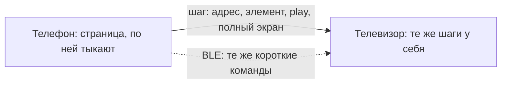

# Parlor: план

Дата: 2026-11-10. Кода приложения нет. Этот файл — источник решений. Чеклист реализации — [CHECKLIST.md](CHECKLIST.md).

## Проблема

Нужен браузер на Android TV, Google TV и обычной Android-приставке, плюс браузер на телефоне. Страница должна открываться на телевизоре: там экран, звук и пульт. Управлять ею с пульта почти невозможно.

Что ломается на практике:

- Сайт ждёт мышь. Меню открывается по наведению, ссылка размером с ноготь, фокус прыгает по DOM в бесполезном порядке или застревает внутри одного блока.
- Текст на пульте набирается экранной сеткой. Поиск, логин и адрес из-за этого бросают.
- Прошивка телевизора и дешёвой приставки отличается от телефона. Системный WebView старый, плотность экрана врёт, видео декодируется иначе, чем в Chrome на ноутбуке. Часть страниц просто не отрабатывает.
- Официального Chrome для Google TV в Play Store нет. Телефонный Chrome, поставленный обходом, рассчитан на касание, а не на пульт. В январе 2026 это прямо подтверждали в сообществе Google TV: нативные приложения DRM используют, а браузер из магазина не ставят.

Сейчас это обходится ноутбуком на том же диване. Parlor переносит страницу на телевизор и оставляет управление на телефоне.

## Что уже сделали другие

Это не пустая ниша. Повторять их один в один не нужно. Дыра в другом: страница на телевизоре, телефон как нормальный пульт и клавиатура, канал не открыт всей квартире, и поломки приставок описаны заранее.

| Продукт | Движок | Телефон | Чего не хватает Parlor |
| --- | --- | --- | --- |
| [TV Bro](https://github.com/truefedex/tv-bro) | Системный WebView | Нет | Зрелый пульт и вкладки, без второй точки управления |
| [Rhenium](https://github.com/smolcars/rhenium) | Форк Brave/Chromium, APK около 130–170 МБ | Веб-страница по QR, в README указан незашифрованный локальный HTTP | Свой Chromium, сборка на Nix, DRM на ARM64 сам проект помечает как непроверенный |
| [Lightning Browser](https://github.com/threethan/LightningBrowser) | GeckoView, движок внутри APK | Нет | Современный движок на старой прошивке, это не Chromium |
| [tv-browser](https://github.com/KeynoWu/tv-browser) | Системный WebView | Страница в браузере телефона, без установки | Близкий прототип: курсор, ввод, QR. Постоянный токен в QR, опрос раз в несколько секунд, телефон не браузер |
| [mrowser](https://github.com/m-salehi-v/mrowser) | WebView плюс свой плеер | Нет | Забирает HLS/DASH в ExoPlayer из-за плохого звука и видео внутри WebView |
| BrowsePad | Своё TV-приложение | Трекпад по Wi-Fi, по описанию страницы в Play | Закрытый продукт, идея трекпада уже проверена рынком |
| Puffin TV | Рендер в чужом облаке | Пульт | Страница уходит третьей стороне. Нам этот путь не подходит |

Вывод: первая версия ближе к TV Bro и tv-browser, чем к Rhenium. Полноценный Chromium на телевизоре уже собирают, и цена известна: отдельное дерево исходников, сотни мегабайт, постоянная пересборка и отдельные поломки DRM. Это запасной путь, не старт.

## Решение

Оба устройства открывают страницу в своём WebView. Во время навигации смотрят в телефон: обычные касания, обычная мобильная вёрстка. Телевизор повторяет те же шаги у себя и на весь фильм переходит сам. Телефон не проксирует чужой сайт и не передаёт картинку экрана. Каждое устройство качает страницу само.

Разный масштаб этому не мешает. Повторяется действие над элементом, а не точка на стекле. «Кнопка Play», «эта ссылка», «это видео на весь экран» находятся и на странице телефона, и на странице телевизора. Полноэкранное видео заполняет телевизор независимо от того, сколько CSS-пикселей было у страницы под ним.

Куки вкладки, которую ведут с телефона, копируются на сопряжённый телевизор по локальному каналу. Иначе фильм на телефоне открыт под логином, а телевизор упирается в стену входа. Это не общий облачный аккаунт и не синхронизация паролей. Некоторые сайты привязывают сессию к одному клиенту и разлогинят одно из устройств. Это записывается как свойство сайта, а не как повод отказаться от повтора шагов.

Два потока сразу многие киносайты не держат. Пока человек в приложении на телефоне, играет телефон, а телевизор повторяет страницу и команды. Кнопка Play и полный экран уходят на телевизор тоже. Как только приложение телефона сворачивают или закрывают, телефон ставит паузу, телевизор продолжает с того же времени и остаётся на весь экран. Кнопка «Оставить в телефоне» делает наоборот: телевизор на паузе, телефон играет дальше. Пауза на самом телевизоре останавливает телевизор и не гасит телефон, пока человек сам не выбрал один экран.

## Режимы

1. **С телефона.** Основной режим. На телефоне обычный браузер. Касание, переход, ввод, Play и полный экран повторяются на телевизоре. Смотреть в телевизор во время этого не нужно. Сворачивание телефона оставляет кино на телевизоре. «Оставить в телефоне» останавливает телевизор.
2. **Курсор.** Запасной, когда элемент на телевизоре не нашёлся: меню только по наведению, холст, карта. Телефон тогда становится тачпадом уже открытой страницы телевизора. Пульт двигает тот же указатель.
3. **Подсказки.** Метки на ссылках телевизора, если смотреть всё-таки на телевизор. В основном режиме не обязательны.
4. **Очередь.** Список адресов на телефоне, телевизор открывает следующий уже как повтор шага «открыть адрес».
5. **Плеер.** Если страница отдала обычный файл, HLS или DASH, полный экран можно отдать своему плееру (Media3 / ExoPlayer) с тем же User-Agent, Referer и куками вкладки. Сам поток со страницы не выдёргивается: у страницы часто свой плеер с сериями и рекламой.
6. **Читалка.** Статья без меню сайта. Жест «открыть читалку» на телефоне открывает её и на телевизоре.

Голос, жесты «потряси телефон», трансляция экрана телефона и облачный рендер в план не входят. Трансляция экрана как раз тащит мелкую мобильную вёрстку на стену и часто даёт чёрный прямоугольник на DRM-видео. Повтор шагов оставляет телевизору его собственный полноэкранный плеер.

## Движок

### Почему WebView, хотя хочется «просто Chromium»

Android System WebView — это Chromium. На сертифицированном Google TV его обновляет Play, отдельно от прошивки. Для первой версии этого достаточно, чтобы проверить идею на живом телевизоре.

Свой Chromium, как у Rhenium, даёт свежий движок на старой приставке и свой сетевой стек. Цена: дерево сборки Chromium, APK 130–170 МБ уже у готового форка Brave, поддержка каждой ветки и чужие регрессии. Осенью 2026 Chromium M153 и M154 ломали Widevine на Android 10 с DRM HAL 1.1; к M157 это закрыли. Свой форк придётся чинить так же часто. Пока матрица устройств не покажет конкретный провал WebView, форк не начинаем.

GeckoView — запасной встраиваемый движок: он везёт современный Firefox внутри APK и поэтому живёт на приставке, где WebView застыл на версии трёхлетней давности. Это уже не Chromium. Имеет смысл только как ответ на измеренную проблему, не как старт.

### Поведение WebView, которое фиксируем сразу

- JavaScript включён. Доступ к `file://` и `content://` выключен. Смешанный контент не грузим.
- Геолокация, камера и микрофон выключены, пока нет отдельного экрана разрешения с пульта.
- Сторонние куки включены: без них половина логинов не живёт.
- Новое окно и `target=_blank` открывают вкладку Parlor, а не внешний браузер. На телевизоре внешнего браузера часто нет.
- Падение процесса рендера не закрывает приложение: показываем ошибку и даём перезагрузить последний адрес.
- Версию WebView читаем при старте. Если мажорная версия Chrome внутри ниже 110, на экране постоянная пометка «движок устарел, часть сайтов не откроется». Порог 110 — рабочая граница современных сайтов, не магическое число; его можно сдвинуть после матрицы устройств.
- Число вкладок на приставке с 1 ГБ памяти ограничиваем. Фон и сон телевизора убивают процесс. После возврата восстанавливаем адрес активной вкладки.

Пользовательский агент в сессии «С телефона» на телевизоре совпадает с телефоном. Иначе сайт отдаёт два разных дерева элементов, и кнопка Play с телефона на телевизоре не находится. Ширина окна при этом всё равно разная: часть сайтов меняет дерево по `matchMedia`, не по агенту. Такие шаги ищем по имени кнопки и по номеру видео. Не найденный шаг телефон не блокирует.

Вне этой сессии у телевизора три пресета. Настольный — широкая вёрстка, когда телевизором пользуются один на один с пульта. Телефонный — если настольная версия разваливается. «Как есть» — системная строка WebView, включая признак `wv`.

Свой агент задаётся через `setUserAgentString`. Google с Android 17 урезает стандартную строку WebView (запись в блоге Android Developers, декабрь 2024): модель устройства оттуда пропадает. На пресет «как есть» это повлияет. На явный пресет — нет. Client Hints при своём агенте могут не совпасть со строкой. Для первой версии это приемлемо.

### Видео и DRM

Полноэкранное HTML5-видео делаем через `WebChromeClient.onShowCustomView` / `onHideCustomView`. Без этого ролик остаётся в маленьком прямоугольнике или даёт чёрный экран. Системные отступы накладываем на полноэкранный вид: иначе кнопки плеера уезжают под системную панель. У WebView это уже всплывало как отдельный дефект оболочки.

Звук оформляем как медиасессию, чтобы play/pause на пульте работал и чтобы уход на домашний экран не оставлял немой звук без управления. Это же требование к качеству TV-приложений (TV-NP).

Widevine привязан к железу, не к браузеру. Уровень L1 нельзя получить обновлением приложения. Сертифицированный телевизор часто имеет L1 для своих приложений, а WebView на той же приставке может не отдать EME или отдать его криво. Дешёвые коробки часто ограничены L3 или не отдают DRM в браузер вовсе. Netflix и похожие сервисы не обещаем: у них может не быть поддерживаемого браузера для этой приставки, даже если приложение из магазина играет 4K.

Свой плеер в режиме «Плеер» использует декодер устройства и те же куки вкладки. DRM-поток туда попадает только если лицензия берётся честно через MediaDrm этого устройства. Обход уровней Widevine не делаем.

### Масштаб и плотность

На части 4K-приставок WebView сообщает `devicePixelRatio = 4`. CSS-окно тогда около 960×540 при физическом 3840×2160. Страница выглядит как увеличенный телефон. Это описано для устройств класса Chromecast, не как закон для всех телевизоров.

Для повтора шагов это не препятствие. Щелчок хранится так:

- адрес перехода, если он сменился;
- элемент: ссылка, доступное имя, тег, устойчивый селектор;
- если попадание внутри виджета важно, точка в долях этого элемента, не в долях экрана. Ползунок на 30% ширины остаётся ползунком на 30% и на стене;
- для видео отдельные команды: play, pause, время в секундах, войти в полный экран, выйти.

Координаты экрана телефона на телевизор не переносятся. На старте одиночного просмотра включаем wide viewport и overview mode, отдельно от масштаба текста. Настройку «принудительная ширина» добавляем только после замера на своей приставке.

## Ввод

Опора — не пространственная навигация Blink. У неё есть зафиксированные ловушки фокуса в Android TV WebView (Chromium 40275154), и с 2019 года её почти не развивают. Курсор и подсказки обходят эту навигацию. Режим «прыгать по элементам» можно добавить позже как дополнение, не как единственный путь.

Пульт:

- Стрелки в режиме фокуса двигают выделение оболочки, когда фокус в нашей панели. Когда фокус на странице и включён курсор — двигают указатель, у края листают страницу под указателем, а не только документ.
- OK — щелчок. Удержание OK переключает курсор и обычные стрелки, не активируя ссылку под курсором.
- Back — назад по истории. С домашнего экрана или с пустой истории — выход. Один Back не закрывает приложение с середины статьи.
- Отдельной кнопки Menu на дешёвом пульте может не быть. Адрес вызывается и с телефона, и длинным Back, если история некуда сдавать.

Телефон в основном режиме — обычная страница под палец, не пульт. Касание остаётся касанием этой страницы. На телевизор уходит описание шага.

Поверх страницы два постоянных действия, оба не меньше 44×44 px:

- **Смотреть на телевизоре.** То же, что свернуть или закрыть приложение: пауза на телефоне, телевизор на том же времени и в полном экране.
- **Оставить в телефоне.** Пауза на телевизоре, телефон продолжает.

Клавиатура — системная клавиатура телефона. Текст в поле уходит на телевизор событием `input`, а не только записью в `value`. Иначе поля на React и Vue на телевизоре не видят ввод. Это уже проверено на прототипе tv-browser.

Трекпад включается только в режиме «Курсор», когда шаг по элементу не применился. Адресная строка в основном режиме принадлежит странице телефона.

Скрипт подсказок выполняется в странице и не хранит ключ сопряжения. Он отдаёт прямоугольники ссылок и по команде шлёт щелчок. Мост `addJavascriptInterface` принимает только запрошенный отчёт с одноразовым номером вызова. Через этот мост нельзя открыть сокет, прочитать файл или получить токен.

Интерфейс телевизора рассчитан на взгляда с дивана: крупный фокус, панель прячется во время просмотра, текст по умолчанию крупнее телефонного. Интерфейс телефона рассчитан на палец: цель не меньше 44×44 px. Это разные шкалы, одна на обе стороны не переносится.

Старые телевизоры режут края картинки. Современный Android TV просит не делать слепой отступ под overscan. Отступ 5% — настройка, выключенная по умолчанию.

## Связь

### Wi-Fi

Основной канал. Телефон и телевизор в одной локальной сети.

1. Телевизор объявляет себя через NSD, тип `_parlor._tcp`. В TXT — имя, версия протокола и признак «нужно сопряжение». Порт выбирается при старте и показывается на экране.
2. На экране сопряжения одноразовый QR и короткий код. В QR — адрес, порт и одноразовый секрет. Постоянный токен в QR не держим: фото главного экрана не должно навсегда отдавать управление.
3. Телефон подключается, телевизор показывает «разрешить?». Совпадение кода или секрета из QR открывает сессию. Дальше устройства хранят свой ключ и соединяются без нового кода, пока пользователь не нажмёт «забыть телефон» на телевизоре.
4. Кадр команды идёт по WebSocket поверх этого ключа. До подтверждения сокет команды не принимает.
5. Если камеры нет, тот же обмен делается вручную: IP, порт и код с экрана.

Сокет слушает только локальные интерфейсы. Проверка заголовка Host отсекает DNS rebinding. Телевизор не проксирует произвольные запросы телефона в интернет: телефон присылает команды, страницу качает сам телевизор.

Команды первой версии: открыть адрес, назад, вперёд, обновить, щелчок по элементу, точка внутри элемента в долях, ввод текста, play, pause, перемотка к секунде, полный экран, выход из полного экрана, «смотреть на телевизоре», «оставить в телефоне». Курсор, подсказки и масштаб — запасные команды. События обратно: адрес, заголовок, нашёлся ли элемент, идёт ли видео, текущая секунда, полный экран.

С телефона VPN и частный DNS часто уводят его из домашней сети, хотя значок Wi-Fi горит. Экран связи говорит об этом отдельно от «телевизор выключен».

### Когда Wi-Fi есть, а сосед не виден

Гостевая сеть, AP isolation, client isolation и часть mesh-сетей дают интернет обоим устройствам и режут пакеты между ними. mDNS тогда тоже молчит. Ручной IP не помогает: маршрута нет. Так устроены и Chromecast, и любые локальные пульты.

Диагностика в приложении:

- Телевизор показывает свой адрес.
- Телефон пытается открыть TCP до него.
- Если интернет на обоих есть, а TCP нет — текст «роутер запрещает устройствам видеть друг друга», без советов в духе «перезагрузите всё». Дальше запасной канал.

Запасной канал — BLE, не передача страницы:

- Телевизор объявляет сервис. Телефон находит его без локальной сети.
- По BLE ходят те же короткие команды: адрес, стрелки, щелчок, текст, назад. Кадр маленький, задержка десятки миллисекунд, для ввода хватает.
- Картинка страницы, файл и видео по BLE не едут. Страницу по-прежнему грузит сам телевизор через свой Wi-Fi.

Класть оба устройства на гостевую сеть, чтобы «починить» изоляцию, не предлагаем. Гостевая сеть для того и сделана.

### Bluetooth HID

Android с 9 версии умеет режим HID-устройства: телефон представляется телевизору обычной клавиатурой и мышью. Отдельное приложение на телевизоре для самого ввода тогда не нужно. На практике профиль HID device выключен у части производителей телефонов, на части приставок пара создаётся и сессия не поднимается, а команды уходят в то приложение, которое сейчас в фокусе. Ссылок, вкладок и адреса у HID нет.

В первой версии HID не используем. BLE и Wi-Fi идут в наше приложение и не зависят от того, собрал ли производитель телефона HID. HID можно вернуть позже как ещё один способ двигать курсор, если матрица телефонов покажет, что профиль живой.

## Состав

Один репозиторий, два приложения и общая библиотека, когда дойдёт до кода:

- `tv` — Android TV / Google TV. Leanback-лаунчер, баннер, `touchscreen` не обязателен. Пакет вида `app.parlor.tv`.
- `phone` — обычный телефон. Пакет вида `app.parlor.phone`.
- `core` — сообщения протокола, без UI.

`minSdk` 24, чтобы ставить на коробки Android 7. Для Play у TV-приложений своя планка: с декабря 2025 минимальная версия SDK должна быть 31 или ниже, чтобы покрывать распространённые телевизоры. 24 этому удовлетворяет. С 1 августа 2026 новые публикации должны быть 64-битными и, если есть нативные библиотеки, с выравниванием 16 КБ. Нативный код до плеера не тянем. Для Play собираем `arm64-v8a`. Отдельная сборка `armeabi-v7a` нужна только для старых 32-битных приставок в стороне от Play: их ещё много.

Fire OS, Tizen и webOS в первую версию не входят. Приёмник Chromecast — тоже: это чужой рендер по чужому протоколу, не браузер.

## Фазы

0. **Этот репозиторий.** План, чеклист, скилы. Сделано, когда документы опубликованы.
1. **Телевизор один.** Адрес, одна вкладка, назад, масштаб, настольный агент, курсор с пульта, восстановление адреса после сна. Без телефона. Цель — увидеть, какие из своих сайтов живы на своей приставке и на своём Google TV.
2. **Повтор шагов.** Сопряжение и основной сценарий: страница на телефоне, те же шаги на телевизоре, Play и полный экран, свёрнутый телефон оставляет кино на телевизоре, «Оставить в телефоне» останавливает телевизор.
3. **Запасной ввод.** Курсор и подсказки для шага, который не нашёлся. Ввод в поля SPA.
4. **Закладки и очередь.** Явная синхронизация закладок. Очередь адресов. Куки по-прежнему только у вкладки, которую ведут.
5. **Плеер по кнопке.** Файл, HLS, DASH в Media3. Без тихого перехвата.
6. **Запасной канал.** Диагностика изоляции и BLE-команды.
7. **Гейт движка.** Решение по записям матрицы: остаёмся на WebView, встраиваем GeckoView или только тогда обсуждаем форк Chromium.

Фаза 1 раньше повтора шагов, потому что Play и полный экран на телевизоре должны уже работать на этой прошивке. Повтор шага не починит чёрный полноэкранный ролик.

## Гейт движка

Форк Chromium открывается только если в матрице устройств записано всё сразу:

- модель, версия Android, версия WebView, 32 или 64 бита, объём памяти;
- конкретный сайт и что именно не работает;
- та же страница в актуальном Chrome на телефоне при этом работает;
- обновление системного WebView невозможно (нет Play или Play не обновляет WebView);
- обход в нашей оболочке исчерпан: агент, масштаб, курсор, плеер, читалка.

Пока хотя бы одного пункта нет, новый движок не подключаем. GeckoView рассматриваем раньше форка Chromium: он встраивается как библиотека и не требует своей фермы сборки.

## Вне первой версии

- Облачная синхронизация куков и паролей. Куки одной ведомой вкладки по локальному каналу — часть режима «С телефона», не этот пункт.
- Общий облачный аккаунт и синхронизация через интернет.
- Блокировщик рекламы. Его легко добавить сетевым фильтром позже; на старте он мешает понять, сломался сайт или фильтр.
- HID, голосовой поиск, расширения Chrome и Firefox.
- Обход DRM, смена уровня Widevine, проксирование чужого трафика.
- Сертификация Play, пока нет стабильной фазы 2 на живом телевизоре.

## Матрица устройств

Заполняется по факту прогона, не заранее. Колонки: модель, Android, WebView, ABI, память, `devicePixelRatio`, агент, что открылось, что сломалось, сон, звук с пульта.

Классы, которые надо иметь в матрице до гейта движка:

- сертифицированный Google TV или Chromecast with Google TV, WebView обновляется из Play;
- дешёвая приставка без сервисов Google, WebView с завода;
- телефон в той же сети;
- телефон с включённым VPN;
- сеть, где устройства друг друга не видят, если такая есть дома.

## Источники

Проверено 2026-11-10.

- TV Bro: <https://github.com/truefedex/tv-bro>
- Rhenium 0.1.1, сборка Chromium, телефон по открытому HTTP, APK arm/arm64: <https://github.com/smolcars/rhenium>
- Lightning Browser на GeckoView: <https://github.com/threethan/LightningBrowser>
- tv-browser, WebView и телефон по QR: <https://github.com/KeynoWu/tv-browser>
- mrowser, курсор и вынос потока в ExoPlayer: <https://github.com/m-salehi-v/mrowser>
- Качество приложений Android TV, в том числе TV-WB, TV-NP, 64-бит и 16 КБ: <https://developer.android.com/docs/quality-guidelines/tv-app-quality>
- Урезание User-Agent в WebView: <https://android-developers.googleblog.com/2024/12/user-agent-reduction-on-android-webview.html>
- Ловушка пространственной навигации в TV WebView: <https://issues.chromium.org/issues/40275154>
- Widevine в Chrome на Android 10, DRM HAL 1.1, регрессия M153–M154: <https://issues.chromium.org/issues/567169241>
- Плотность WebView и окно 960×540 на 4K-приставке: <https://stackoverflow.com/questions/76426418/why-is-android-tv-app-having-a-web-view-with-low-resolution>
- Сообщество Google TV, браузер с Widevine из Play не ставится (январь 2026): <https://support.google.com/googletv/thread/405700726/widevine-cdm-compatible-browser-on-google-tv>
- AP isolation режет локальные устройства, справка Chromecast: <https://support.google.com/chromecast/answer/3213084>
- Bluetooth HID device есть не на каждом телефоне; описание профиля и отказов: <https://github.com/raghavk92/Kontroller>
